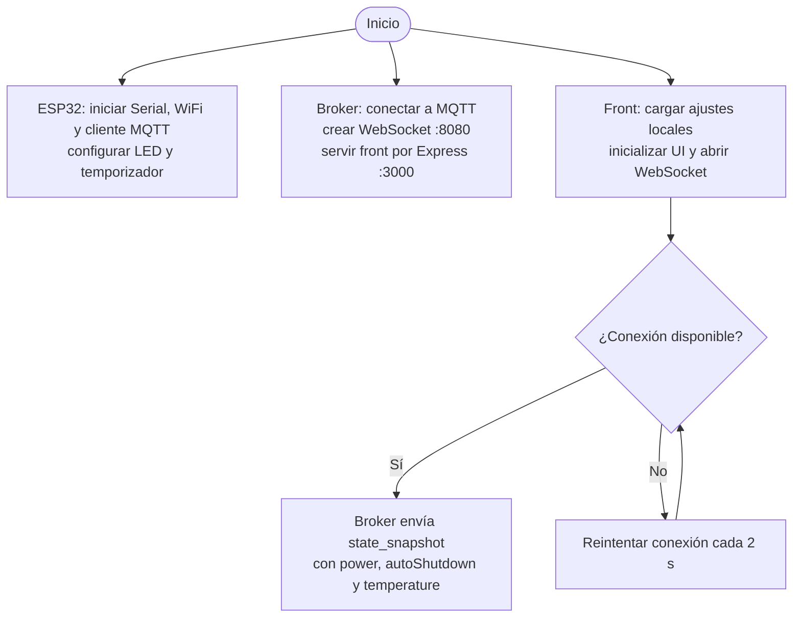
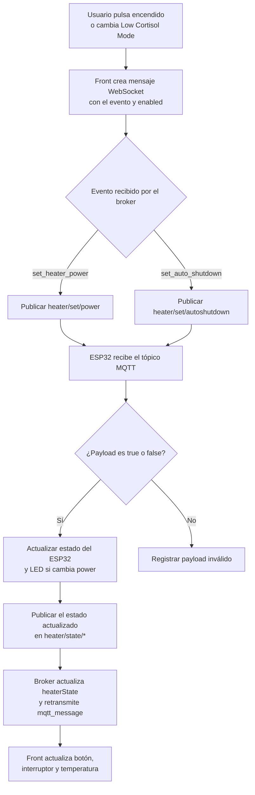
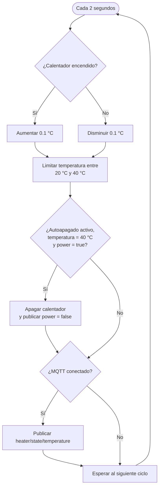

# How to run dis

## How to run esp32

js open the esp32 folder as a platformio project in vscode, then upload and monitor
dont forget to put ur stuff in include/secrets.h (ssid, password)

## how to run broker

go to broker folder, npm i, npm run dev, profit. node app runs both broker and frontend.

## firewall

don't forget to open ports lol, smth like this:

```
sudo ufw allow from 192.168.1.0/24 to any port 8080 proto tcp
sudo ufw allow from 192.168.1.0/24 to any port 3000 proto tcp
sudo ufw allow from 192.168.1.0/24 to any port 1883 proto tcp
```

8080 for broker,
3000 for front,
1883 for mqtt

## Arquitectura general

```mermaid
flowchart LR
    UI["water-heater/front<br/>HTML + CSS + JavaScript"]
    WS["water-heater/broker/src/websocket/server.ts<br/>WebSocket :8080"]
    APP["water-heater/broker/src/index.ts<br/>Express :3000<br/>Estado en memoria"]
    MQTT["water-heater/broker/src/mqtt/client.ts<br/>Cliente MQTT"]
    BROKER["Mosquitto<br/>MQTT :1883"]
    ESP["esp32/src/main.cpp<br/>ESP32 + sensor/modelo térmico"]
    LED["LED integrado"]
    UI -->|"set_heater_power<br/>set_auto_shutdown"| WS
    WS --> APP
    APP -->|"heater/set/power<br/>heater/set/autoshutdown"| MQTT
    MQTT <-->|"MQTT"| BROKER
    BROKER <-->|"heater/set/*<br/>heater/state/*"| ESP
    ESP --> LED
    MQTT -->|"heater/state/*"| APP
    APP -->|"mqtt_message<br/>state_snapshot"| WS
    WS --> UI
```

## Inicio de los componentes

## Flujo de control del calentador

## Ciclo térmico del ESP32
El ESP32 usa `tick()` cada 2 segundos. La temperatura simulada aumenta
cuando el calentador está encendido y disminuye cuando está apagado (20 °C - 40 °C).

