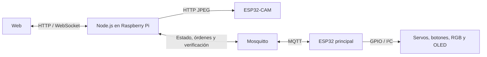

# Terma Erma

Prototipo para observar el visor y operar los botones de una terma Rheem desde
la web. La cámara y el sensor RGB observan el panel. El ESP32 principal mueve
los servos exteriores y actualiza el OLED. La termorregulación sigue a cargo de
la terma.

## Código

| Ruta | Responsabilidad |
| --- | --- |
| [esp32](esp32/README.md) | Periféricos, control de la terma, máquina de ajuste y protocolo MQTT. |
| `water-heater/broker/src/camera/` | Capturas JPEG, brillo, recorte adaptable, OCR y evidencia del visor. |
| `water-heater/broker/src/heater/` | Estado observado, objetivo de la web, verificación de operaciones y diagnóstico. |
| `water-heater/front/` | Controles y presentación. `js/socket.js` gestiona la conexión y `js/temperature-view.js` presenta las lecturas. |

## Vocabulario

| Nombre en la web | Significado | Campo en el sistema |
| --- | --- | --- |
| Temperatura | Temperatura del agua que muestra el visor en reposo. | API `temperature`; código `waterTemperature`. |
| Temperatura máx. | Consigna física observada en el visor durante la selección. | API `temperatureMax`. La estimación interna del ESP es `base` en MQTT. |
| Temperatura objetivo | Máxima solicitada en la web. El objetivo guardado y la máxima observada pueden estar temporalmente separados. | Web `requestedTemperature`, API `desired.temperature`. |
| Piloto LED | Luz de la terma. El sensor RGB distingue rojo (calentando) y verde (lista). | API `pilot`; muestra cruda en `heater/state/color`. |
| Última lectura | Valor histórico de temperatura que sigue visible durante una falta de lectura o mientras la terma está apagada. | La web lo etiqueta. El valor retenido del OLED también es de presentación. |

El ajuste toma el trayecto con menos pulsaciones en el rango circular de 30
a 75 °C. Empieza mientras el visor parpadea si la cámara puede leer la máxima
tras el primer toque. Las órdenes de temperatura usan QoS 1 con capacidad del
ESP y configuración activadas. El ESP deduplica por ID y valida la vigencia.
La cámara confirma el resultado físico. El OLED usa una caché retenida
separada del control.

## Desarrollo y operación

- Backend y web juntos. En `water-heater/broker`, usar `npm ci`,
  `npm test` y `npm run build`. La Pi sirve HTTP en 3000 y WebSocket en 8080.
  La configuración privada va en `.env`; sus claves se describen en
  [el ejemplo](water-heater/broker/.env.example).
- Firmware principal. Usar las instrucciones de [ESP32](esp32/README.md).
  La configuración de la red va en `include/secrets.h`, fuera de Git.
  El banco Hall usa el perfil `esp32doit-devkit-v1-flow`; en la terma sin cablear
  el canal figura como no disponible.
- [Despliegue, aceptación y diagnóstico en la Pi](water-heater/broker/deploy/rpi/README.md).
